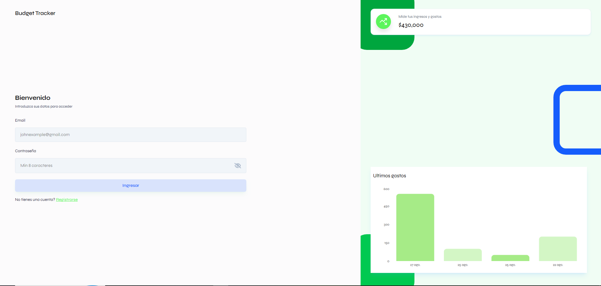

# Budget Tracker

Aplicación web para llevar el control de las finanzas personales. Permite registrar ingresos y gastos, consultar el balance y visualizar los movimientos recientes desde un panel.

## Muestra



## Funcionalidades

- Registro e inicio de sesión de usuarios.
- Panel con balance, ingresos, gastos y transacciones recientes.
- Registro, consulta y eliminación de ingresos y gastos.
- Resúmenes visuales de los movimientos financieros.
- Exportación de ingresos y gastos a archivos Excel.
- Carga de imagen de perfil.

## Tecnologías

- **Frontend:** React, Vite, Tailwind CSS y Recharts.
- **Backend:** Node.js, Express y MongoDB con Mongoose.
- **Autenticación:** JSON Web Tokens (JWT).

## Estructura del proyecto

```text
backend/                  API REST y conexión con MongoDB
frontend/budget-tracker/  Aplicación web en React
```

## Requisitos

- Node.js y npm.
- Una instancia de MongoDB local o remota.

## Configuración y ejecución

### 1. Configurar el backend

En `backend`, crea un archivo `.env` con estas variables:

```env
MONGO_URI=tu_uri_de_mongodb
JWT_SECRET=una_clave_secreta
PORT=8000
CLIENT_URL=http://localhost:5173
```

El frontend está configurado para conectarse a `http://localhost:8000`. Si eliges otro puerto para el backend, actualiza `BASE_URL` en `frontend/budget-tracker/src/utils/apiPaths.js`.

Instala dependencias e inicia la API:

```bash
cd backend
npm install
npm run dev
```

### 2. Iniciar el frontend

En otra terminal:

```bash
cd frontend/budget-tracker
npm install
npm run dev
```

Abre en el navegador la dirección local que indique Vite (normalmente `http://localhost:5173`).
